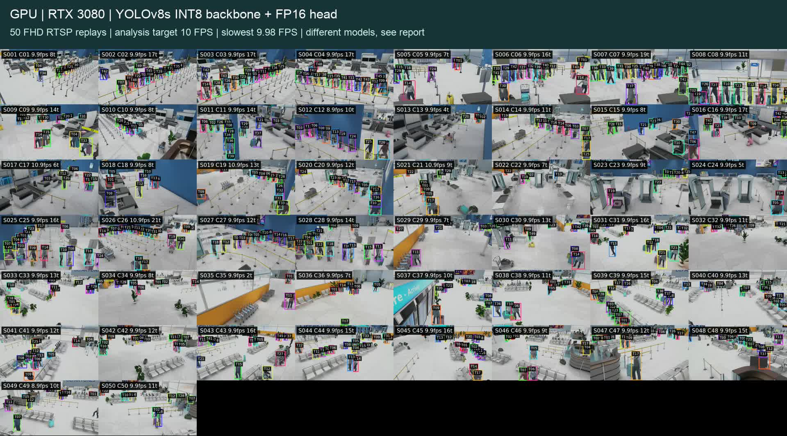
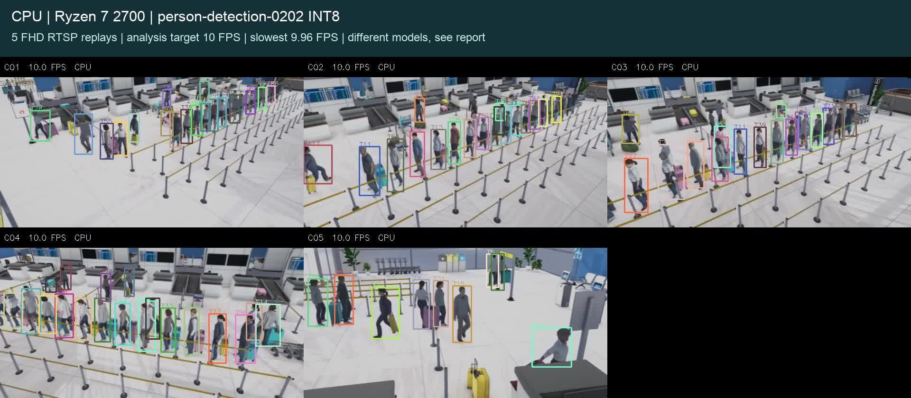

# CPU and GPU results

Measured on 4-5 November 2026. Host: Ubuntu 22.04, Ryzen 7 2700 (8 physical cores / 16 threads), about 24 GB RAM, RTX 3080 10 GB. Sources were synthetic Full HD H.265 RTSP replays at 10 FPS. These are detector/tracker reference results, not a benchmark of the entire CAMEX product.

| Profile | Feeds | Measured window | Slowest FPS | Post-decode P95 | Host CPU mean | GPU mean |
|---|---:|---:|---:|---:|---:|---:|
| GPU YOLOv8s INT8 backbone / FP16 head, NvDCF | 50 | 600 s | 10.00 | 74.0 ms | 23.7% | 34.9% |
| CPU OpenVINO person-detection-0202 INT8, ByteTrack | 5 | 600 s | 10.00 | 59.4 ms | 44.4% | 0.0% |

Both passed the review gate: each input averaged at least 9.8 FPS against a 10-FPS target, completed the window, and had no reported runtime/schema/metadata-drop error. GPU pipeline frame-age P95 also stayed below 300 ms. Neither latency number is physical camera-to-alert latency. CPU percentages are whole-host utilization across logical CPUs.

## Boundary tests and interpretation

- The 100-feed test used two 50-feed workers on the same RTX 3080 and a common 600-second measurement window. It reached 9.835 FPS minimum and about 992.9 FPS aggregate, but pipeline frame-age P95 was 326.8 ms. It missed the chosen latency limit and is not the recommended profile.
- The unchanged YOLOv8s CPU model remained around 9-11 total model-only FPS across scheduling/batch experiments. It did not meet five cameras at 10 FPS on this processor.
- The faster CPU model is a different MobileNetV2/SSD detector. Ten-camera end-to-end tests were around 7.2 FPS each; more threads and an H.264 variant did not solve that limit.
- Smaller YOLO variants were screened, but their reference agreement was not sufficient to claim equivalent quality.
- Early high-count file playback could catch up faster than real time. Those diagnostic runs are excluded from the accepted capacity result. The release adds pacing and source-rate/timestamp-span checks; RTSP replay is the primary long-run evidence.
- Early 100-feed startup/allocation attempts failed. Reducing buffers and staging workers helped initialization, but did not eliminate the latency limitation.

## Quality is a separate decision

| Candidate | Comparison sample | Precision against reference | Recall against reference |
|---|---|---:|---:|
| GPU INT8/FP16 head | 100 held-out timestamps | 98.9% | 96.1% |
| CPU person-detection-0202, confidence 0.5 | 60 timestamps from 20 clips | 84.9% | 82.4% |

The reference is YOLOv8s FP32, matched at IoU 0.5. These are box-agreement measurements, **not labeled field accuracy**. Samples come from the same synthetic scene family, not an independent customer/site dataset. In particular, the faster CPU detector must not be advertised as accuracy-equivalent. Validate it on authorized client footage before adoption.

The GPU path uses RGB 640x640 letterbox input at confidence 0.25. The fast CPU path uses BGR 512x512 direct resize at confidence 0.5. Both receive the original FHD streams and return native-pixel coordinates.

## Video evidence

[GPU 50-feed video](https://github.com/Niraj-2803/GPU-Pipeline/releases/download/pipeline-reference-20261105/gpu50_video.mp4) · [CPU five-feed video](https://github.com/Niraj-2803/GPU-Pipeline/releases/download/pipeline-reference-20261105/cpu5_video.mp4)

Both are 45-second silent recordings. Recording adds work and is not included in the headless table above. The final GPU preview averaged at least 9.98 FPS per source; the CPU preview averaged at least 9.96. The GPU startup guard was tightened to require fresh source output before warmup, then checked in the final recording. Do not confuse preview frame rate with analysis throughput.

## Reproduction and remaining work

README contains the commands. [results/summary.json](results/summary.json) contains sanitized measurements and model hashes; raw source URLs and machine-specific logs are not committed. The original local raw records are retained for investigation.

32 tests passed in the original optimization review. Metadata from the two accepted long runs was independently checked: 329,989 records, including 3,300 full-schema samples. Maximum measured output gaps were below 0.25 seconds. The release adds helper/adapter tests and clean-checkout verification separately in [results/release_verification.json](results/release_verification.json).

Still required for a production claim: actual camera/network testing, labeled detection/tracking evaluation, full CAMEX analytics/model load, multi-day soak, failover, security and retention acceptance. Hardware changes require a new benchmark. Use the qualified GPU profile for the original YOLO path; treat the fast CPU detector as an opt-in quality-dependent alternative.
